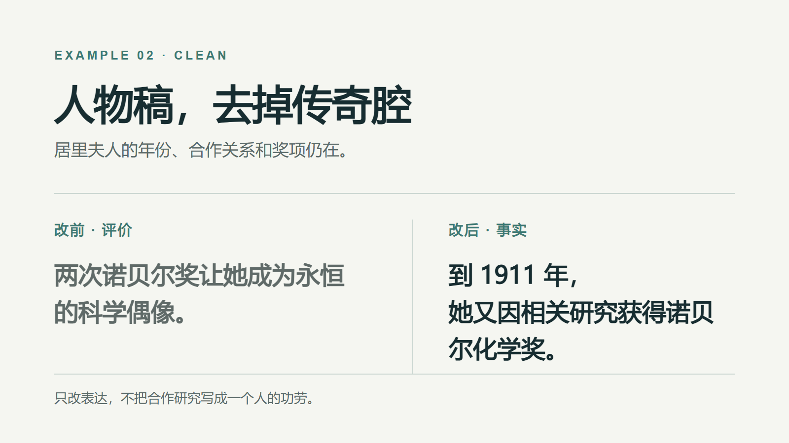
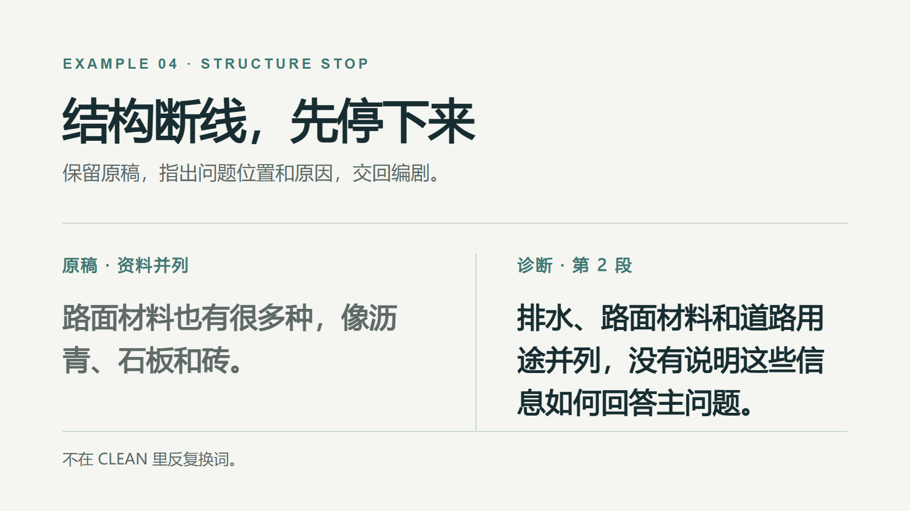
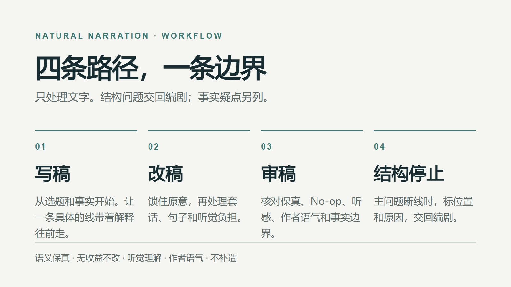

<div align="center">

# Natural Narration

**让中文口播像一个懂行的人，顺着事实自然讲下去。**

写稿 · 改稿 · 审稿　｜　v0.9.0　｜　纯文字 Skill

</div>

写知识、科普、人物或方法论口播时，它先看事实和原意，再处理句子、节奏与听感。通顺的句子可以不改；结构断了，就指出位置，交回编剧。


> **Before**：「改写人类科学史的传奇」「只要坚持，就一定能创造奇迹。」<br>
> **After**：从 1891 年求学、1903 年研究与获奖讲起，交代具体经历。<br>
> 改动的是表达；年份、人物关系和奖项不变。<br>
> 完整原稿与改稿见 [02｜人物 CLEAN](examples/02-clean-person/)。

## What it does｜能做什么

| 工作 | 交付 |
| --- | --- |
| **写稿 WRITE** | 从选题和可信事实出发，写一篇能直接朗读的中文稿。 |
| **改稿 CLEAN** | 去掉套话和说服腔，保留原意、数字、条件和作者语气。 |
| **审稿 REVIEW** | 指出听不懂、重复、失真或证据不足的位置。 |

## What it does NOT do｜不做什么

- 不生成视频、配音、字幕工程或卡片。
- 不补造数字、人物经历和因果。疑点单列「事实待核」。
- 发现主问题断线或资料堆砌时，只诊断具体段落并交回编剧，不靠反复换词掩盖结构问题。

## Core checks｜每次必查五项

1. **语义保真**：否定、确定程度、状态、条件、范围、归因和因果不被改坏。
2. **无收益不改**：一句话已经通顺准确，就原样保留。
3. **听觉理解**：朗读时能跟上指代、数字、长句和专有名词。
4. **作者语气**：保留必要的态度、幽默和犹豫。
5. **不补造**：不为生动而编造事实或现场。

## Install｜安装

仓库根目录就是 Skill。克隆到技能目录即可：

```bash
mkdir -p ~/.agents/skills
git clone https://github.com/Gerson369/natural-narration.git ~/.agents/skills/natural-narration
```

入口文件是 `~/.agents/skills/natural-narration/SKILL.md`。脚本只用 Python 标准库。

## Usage｜直接调用

```text
$natural-narration 写一篇 1 分钟科普口播：冰水杯外面的水珠从哪里来？只用我给的事实，不补数字。

$natural-narration CLEAN 这篇人物口播：去掉套话，保留年份、归因和确定程度；通顺的句子不要改。

$natural-narration 审这篇稿：标出听觉理解问题、事实待核项；若结构断线，只给段落位置和原因。
```

## Tools｜包内工具

| 脚本 | 用途 |
| --- | --- |
| `scripts/quick_validate.py .` | 检查技能文件、引用和包内约束。 |
| `scripts/nn_scan.py 稿件.md` | 给出语言、节奏和重复模式的复查线索。 |
| `scripts/nn_scan.py --baseline 原稿.md --after 改稿.md --fidelity-gate` | 检查 CLEAN 的语义锚点；通过后仍需人工核对。 |
| `scripts/nn_scan.py --baseline 原稿.md --after 改稿.md --noop-gate` | 检查原稿已经通顺时是否被过度改动。 |
| `scripts/nn_blueprint_check.py 稿件.md --thread 杯壁,空气 --topic 凝结` | 提示主线和结构风险；结构分不是交稿门槛。 |
| `scripts/nn_structure_check.py 原稿.md 改稿.md` | 检查 Markdown 的受保护结构是否保留。 |

命令中的 `稿件.md`、`原稿.md` 等是示例路径。脚本参数以各自的 `--help` 为准。

## Examples｜四种处理结果

每个案例都有 `input.md`、`output.md`、`notes.md` 和 `command.txt`。文字均为原创；人物与科普案例在注释里列出事实来源。

| 案例 | 看点 |
| --- | --- |
| [01｜科普首稿](examples/01-first-draft-science/) | 一只冰水杯，从观察水珠走到凝结的解释。 |
| [02｜人物 CLEAN](examples/02-clean-person/) | 居里夫人稿：去掉传奇腔，保留年份、合作与奖项。 |
| [03｜方法论 No-op](examples/03-noop-method/) | 原稿已通顺，结果逐字不变。 |
| [04｜结构停止](examples/04-structure-stop/) | 原稿资料并列，保留原文并指出断线段落。 |

<p align="center">
  <a href="examples/01-first-draft-science/"></a>
  <a href="examples/02-clean-person/"></a>
  <a href="examples/03-noop-method/"></a>
  <a href="examples/04-structure-stop/"></a>
</p>



## Changelog｜更新记录

当前版本是 v0.9.0。结构检查改为风险诊断；CLEAN 遇到结构问题会停止；新增听觉理解和无收益不改的检查。完整变更见 [CHANGELOG.md](CHANGELOG.md)，版本说明见 [VERSION.md](VERSION.md)。

## License｜开源说明

本项目按 [MIT License](LICENSE) 开源。使用、修改和再发布时，请保留版权及协议声明。
